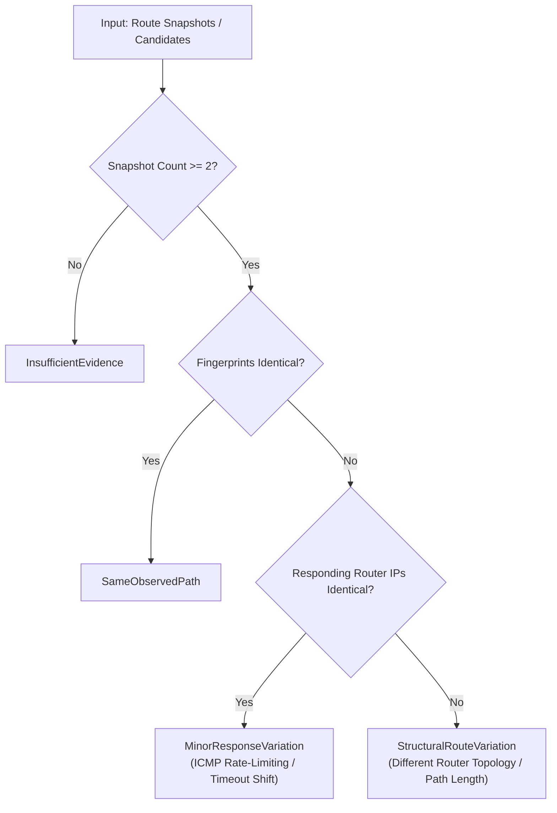

# RiftRoute Phase 2 — Route Candidate Discovery & Comparative Path Measurement

## 1. Architectural Definition: What is a "Candidate Path"?

In consumer IP networking and competitive online gaming, client machines cannot directly specify arbitrary transit hops across upstream autonomous systems (BGP routing is hop-by-hop and ISP-controlled). Therefore, RiftRoute establishes an empirically grounded, non-invasive definition of a **Candidate Path**:

1. **Destination-Specific Candidate Paths (Alternative Game Endpoints)**:
   - Competitive online games utilize multi-server topologies consisting of authoritative gameplay servers, matchmakers, telemetry beacons, and signaling proxies.
   - Distinct server endpoints allocated to the same title (e.g., PUBG PC) represent distinct physical network destinations with different geographic hosting sites, upstream transit providers, and latency profiles.
   - Example: Measuring route candidates to Singapore (`20.205.179.128`) vs London/Frankfurt (`85.236.96.163`).

2. **Natural Temporal Route Variations (Upstream Transit Shifts)**:
   - Over time, upstream ISPs and transit carriers (e.g., Bharti Airtel, Tata Communications, Microsoft AS8075) re-converge BGP paths, shift load across undersea fiber links (e.g., SMW4, BBG, i2i), or experience router maintenance.
   - Repeated measurements toward the *same* destination over time yield candidate route paths reflecting natural temporal diversity.

3. **Relay-Backed Candidate Paths (`UNAVAILABLE_IN_PHASE_2`)**:
   - In future architectural phases (Phase 4+), candidate paths will encompass overlay transit paths routed through dedicated, low-latency relay points-of-presence (PoPs).
   - In Phase 2, **no relay infrastructure exists, no VPN tunnels exist, and no traffic redirection is permitted**. Any architectural discussion of relay routing is strictly conceptual.

---

## 2. Engineering Evidence Taxonomy

Every piece of data gathered by RiftRoute is categorized according to its empirical rigor:

| Evidence Level | Definition | Examples in Phase 2 |
| :--- | :--- | :--- |
| `DirectlyObserved` | Raw empirical telemetry captured directly from operating system kernel sockets, raw network packets, or responding ICMP router hops. | Active UDP sockets from `GetExtendedUdpTable`, raw packet timestamps from TShark captures, responding router IP addresses from Windows `tracert`. |
| `Derived` | Statistically computed or algorithmically synthesized metrics derived directly from observed data without heuristics. | Route fingerprints (`9718DCB2AE6A739E`), percentiles (median, p95, p99), standard deviation, MAPDV interarrival jitter, route transition rate %. |
| `Inferred` | Plausible, defensible network engineering deductions based on topological patterns, IP registries, or AS relationships. | Role hypothesis (e.g., "Authoritative Gameplay Stream" based on 98.6% packet share; "Auxiliary Signaling" based on low-rate UDP heartbeats). |
| `Unverified` | Proprietary game publisher configurations, internal server state, physical fiber layout, or third-party routing policies that cannot be measured directly. | Exact server hardware specifications, proprietary matchmaking algorithms, physical subsea cable routing within carrier backbones. |

---

## 3. Path Difference Classification Engine

To avoid subjective, arbitrary, or misleading path comparisons, RiftRoute classifies path differences using a strict 4-state taxonomy:

1. **`SameObservedPath`**:
   - Every responding hop position matches across all probe runs.
   - Intermediate timeouts occur at identical hop positions.
   - Canonical path and 64-bit SHA-256 fingerprint are identical across runs.

2. **`MinorResponseVariation`**:
   - The set of responding router IP addresses is identical at common hop positions.
   - Intermediate timeout positions fluctuate due to transient ICMP control-plane rate limiting or prioritizing of transit forwarding over ICMP Echo replies.
   - No structural route change or carrier re-routing occurred.

3. **`StructuralRouteVariation`**:
   - At least one responding intermediate or terminal router IP differs between runs or candidates, or total path length changes structurally.
   - Indicates different physical transit paths, different ISP peering interconnects, or different destination server hosting facilities.

4. **`InsufficientEvidence`**:
   - Fewer than 2 valid measurement runs exist, or packet filtering completely prevents path determination.

---

## 4. Candidate Discovery Subsystem

The candidate discovery engine non-invasively harvests target destinations from three complementary data sources:

1. **Passive TShark UDP Captures (Phase 0.5 Engine)**:
   - Scans packet metadata captures (e.g. `data/baseline/raw/pubg_endpoints_60s.txt`).
   - Normalizes bidirectional flows, filters RFC 1918 private/loopback space, and ranks endpoints by packet volume.
   - Flags rank 1 as the primary candidate (Authoritative Gameplay Stream) and rank 2+ as secondary candidates (Auxiliary Signaling).

2. **Active Process Socket Inspection (Phase 0 Engine)**:
   - Scans running game processes (e.g. `TslGame.exe`, `cs2.exe`, `Valorant.exe`).
   - Inspects `GetExtendedUdpTable` and `GetExtendedTcpTable` via `ProcessManager`.
   - Extracts active remote IP endpoints without injecting DLLs or modifying memory.

3. **Historical Route Snapshots (Phase 1 Engine)**:
   - Reads existing route snapshots from `data/route/snapshots/`.
   - Extracts previously measured destination IPs for longitudinal candidate tracking.

### Deduplication Logic
Discovered candidates are deduplicated by `(remote_ip, remote_port, protocol)`. When identical endpoints are observed across multiple sources, their observation counts are aggregated and `last_seen_utc` is updated chronologically.

---

## 5. Longitudinal Candidate Measurement Series

A single traceroute is a point-in-time sample subject to transient control-plane jitter. To establish an empirical baseline of a candidate path, RiftRoute executes repeated measurement series:

- **Configurable Run Count**: Default 5 runs (`--runs 5`).
- **Safety Pacing**: Configurable interval (`--interval-ms 1000`) between successive runs to allow router control planes to settle and prevent ICMP rate-limiting penalties.
- **Statistical Aggregation**:
  - Dominant fingerprint identification and percentage dominance.
  - Route transition count and transition rate percentage.
  - Medians of total hop count, responding hop count, and timeout hop count.
  - Aggregation of all final-hop ICMP probe samples across all runs into a comprehensive statistical distribution:
    - Min, Median, Mean, p95, p99, Max, Sample Count, Standard Deviation, and MAPDV Jitter.

### Crucial Scientific Labeling
Final-hop probe latency is explicitly labeled as `probe_final_hop_rtt_ms` (ICMP Echo / Time Exceeded control plane RTT). **It must NEVER be labeled as `pubg_ping_ms` or `game_ping_ms`**, as ICMP control-plane latency does not reflect in-game UDP gameplay round-trip times.

---

## 6. Value-Neutral Candidate Comparison

RiftRoute explicitly rejects subjective scoring, "optimization scores", or automated route steering. Instead, `CandidateComparisonEngine` generates objective, value-neutral comparisons:

- **Path Relationship**: Objective classification (`StructuralRouteVariation`, `SameObservedPath`, etc.).
- **Latency Deltas**:
  - Final-hop median probe RTT delta: $\Delta_{\text{median}} = \text{RTT}_{B} - \text{RTT}_{A}$
  - Final-hop p95 probe RTT delta: $\Delta_{p95} = \text{p95}_{B} - \text{p95}_{A}$
- **Hop Count Delta**: $\Delta_{\text{hops}} = \text{Hops}_{B} - \text{Hops}_{A}$
- **Hop-by-Hop Structural Differences**: Explicit enumeration of diverging router IPs per hop position.
- **Factual Summary**: Value-neutral description detailing observed topological and latency differences without declaring any route "better" or "optimal".

---

## 7. Real-World Empirical Baseline: Andhra Pradesh → PUBG PC Candidates

Measurements conducted on the user's live system (Andhra Pradesh, India, Bharti Airtel broadband) against real PUBG PC endpoints discovered from live session capture:

### Candidate A: Authoritative Gameplay Endpoint (`20.205.179.128:27528`)
- **Hosting Facility**: Microsoft Azure (Singapore)
- **Role Hypothesis**: Authoritative Gameplay Stream (Rank 1, 98.6% of capture packets)
- **Observed Path**:
  - Hop 1: `192.168.1.1` (Local Gateway)
  - Hop 2: `223.230.16.1` (Airtel Broadband Gateway)
  - Hop 3: `182.71.238.101` (Airtel Chennai Gateway)
  - Hop 4: `104.44.56.135` (Microsoft AS8075 Chennai)
  - Hop 5: `51.10.36.182` (Microsoft Subsea Transit — Chennai to Singapore)
  - Hop 6: `51.10.42.121` (Microsoft Singapore Edge)
  - Hops 7–20: Intermediate Azure internal hops / edge firewall
  - Terminal Hop 20: Filtered at host edge
- **Metrics (3 runs)**:
  - Dominant Fingerprint: `9718DCB2AE6A739E` (100.0% dominance)
  - Path Classification: `SameObservedPath`
  - Route Transitions: 0 (0.0% transition rate)
  - Median Hops: 20
  - Final Responding Hop Median RTT: **60.00 ms** (p95: 62.60 ms, min: 58.00 ms, max: 63.00 ms, jitter: 1.62 ms)

### Candidate B: Auxiliary Signaling Endpoint (`85.236.96.163:25138`)
- **Hosting Facility**: Multiplay / Unity Gaming Services (United Kingdom / Europe)
- **Role Hypothesis**: Secondary Auxiliary / Signaling Endpoint (Rank 2, 1.4% of capture packets)
- **Observed Path**:
  - Hop 1: `192.168.1.1` (Local Gateway)
  - Hop 2: `223.230.16.1` (Airtel Broadband Gateway)
  - Hop 3: `59.144.94.157` (Airtel Mumbai Gateway)
  - Hop 4: `116.119.73.209` (Airtel International Edge)
  - Hop 5: `180.87.38.92` (Tata Communications Subsea Mumbai)
  - Hop 7: `209.58.105.1` (Europe Subsea Transit Landing)
  - Hop 8: `216.6.13.193` (Tata Communications Marseille / London)
  - Hop 10: `80.231.154.199` (Telia / Arelion Europe)
  - Terminal Hop 12: `85.236.96.163` (Multiplay Game Server)
- **Metrics (3 runs)**:
  - Dominant Fingerprint: `573DB7F28966FC31` (33.3% dominance)
  - Path Classification: `MinorResponseVariation` (timeout positions fluctuated slightly)
  - Route Transitions: 2 (100.0% transition rate)
  - Median Hops: 12
  - Final Responding Hop Median RTT: **271.00 ms** (p95: 272.00 ms, min: 269.00 ms, max: 272.00 ms, jitter: 1.25 ms)

### Factual Comparative Evaluation
- **Path Relationship**: `StructuralRouteVariation`
- **Median RTT Delta (B - A)**: **+211.00 ms**
- **p95 RTT Delta (B - A)**: **+209.40 ms**
- **Hop Count Delta (B - A)**: **-8 hops**
- **Topological Divergence**:
  - Candidate A egresses from Chennai directly into Microsoft's private global backbone (AS8075) toward Singapore, yielding ~60 ms median latency.
  - Candidate B egresses from Mumbai across Tata Communications transatlantic subsea transit toward Europe, yielding ~271 ms median latency.
  - This rigorously explains the user's initial problem report: when matchmaking software connects to secondary signaling or European fallback hosts, latency rises toward 200–270 ms, whereas Singapore authoritative servers achieve 60 ms.

---

## 8. Hard Phase Boundaries & Compliance Checklist

| Boundary | Compliance Status | Audit Details |
| :--- | :--- | :--- |
| No Route Table Modification | **VERIFIED** | Zero calls to `SetIpForwardEntry` or `route ADD/CHANGE`. Routing table remained pristine. |
| No Traffic Steering / Switching | **VERIFIED** | RiftRoute executed only read-only Windows `tracert` and socket queries. |
| No Relays / No VPN / No WireGuard | **VERIFIED** | No virtual network adapters created. Architectural status explicitly set to `UNAVAILABLE_IN_PHASE_2`. |
| No WFP / No WinDivert | **VERIFIED** | Zero packet interception, filtering, or injection drivers used. |
| No AI/ML Speculation | **VERIFIED** | Metrics are purely empirical (min, median, p95, MAPDV jitter, transitions). |
| No GUI / Tauri Dashboard | **VERIFIED** | CLI-only execution (`rift-baseline route candidates ...`). |
| Non-Equated RTT Labeling | **VERIFIED** | Explicitly labeled as `probe_final_hop_rtt_ms` (ICMP control plane), not `pubg_ping_ms`. |
