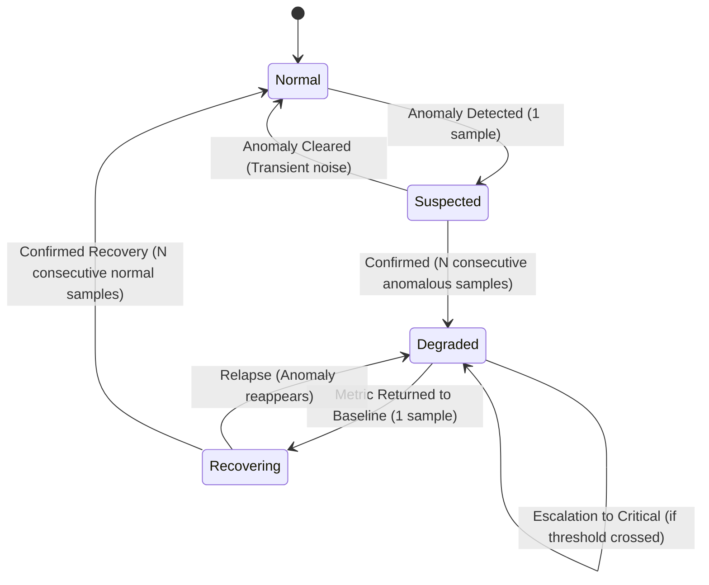

# RiftRoute Phase 3 — Audited Event Model & State Machine

## 1. Lifecycle State Machine

RiftRoute Phase 3 manages path health through a deterministic 4-state finite state machine:



### State Definitions
- **Normal**: Path metrics fall within established baseline tolerances. Rolling baseline dynamically updates.
- **Suspected**: A single anomaly has been detected. Waiting for confirmation samples to distinguish real degradation from transient network noise. Baseline updates are suspended.
- **Degraded**: Network path degradation is confirmed across consecutive samples. Baseline is frozen. Audited degradation event emitted.
- **Recovering**: Path metrics have returned to normal tolerances following degradation. Awaiting confirmation samples before declaring full restoration.

---

## 2. Event Taxonomy

| Event Type | Default Severity | Description |
|:---|:---|:---|
| `RouteChanged` | `Info` | Route fingerprint changed from dominant baseline fingerprint (`ROUTE_CHANGED != ROUTE_DEGRADED`). |
| `LatencyDegraded` | `Warning` / `Critical` | Final-hop probe RTT exceeded baseline relative % and absolute delta thresholds across confirmed samples. |
| `JitterDegraded` | `Warning` | Probe delay variation exceeded baseline jitter relative % and absolute thresholds. |
| `PathStabilityDegraded` | `Warning` | Frequent route switching or transition rate exceeded threshold (> 50%). |
| `HopStructureChanged` | `Info` | Intermediate router address changed, or hop added/removed along path. |
| `MeasurementFailure` | `Warning` | Diagnostic probe execution error (e.g. process timeout, OS error). |
| `TargetUnreachable` | `Critical` | Target endpoint elicited 0 responses across all hops (100% path timeout). |
| `Recovered` | `Info` | Metrics returned within normal baseline parameters for confirmed recovery cycles. |

---

## 3. Audited Event Schema

Every event emitted by RiftRoute contains complete empirical context:

```json
{
  "event_id": "evt_deg_20261002132747123",
  "target_id": "target_cand_20_205_179_128_27528",
  "timestamp_utc": "2026-10-02T12:08:00Z",
  "event_type": "LatencyDegraded",
  "state": "Degraded",
  "severity": "Critical",
  "evidence_description": "Final-hop probe RTT increased by +60.00 ms (+100.0%) over baseline 60.00 ms",
  "baseline_median_rtt_ms": 60.0,
  "observed_median_rtt_ms": 120.0,
  "median_delta_ms": 60.0,
  "median_relative_change_pct": 100.0,
  "baseline_jitter_ms": 1.0,
  "observed_jitter_ms": 1.0,
  "baseline_fingerprint": "FP_A",
  "observed_fingerprint": "FP_A",
  "consecutive_count": 3,
  "measurement_ids": [
    "meas_synthetic_FP_A_0008"
  ],
  "resolved_at_utc": null,
  "scientific_disclaimer": "Traceroute RTT reflects ICMP control-plane generation latency, not in-game UDP gameplay latency. Route degradation events indicate empirical path variation and do not modify network routing."
}
```

---

## 4. Event Persistence & Storage

Events are saved to `data/monitoring/events/` named by session ID:
- File format: `events_<session_id>.json`
- Each record is immutable and time-stamped in UTC.
- Facilitates post-incident correlation, ISP performance auditing, and validation.
