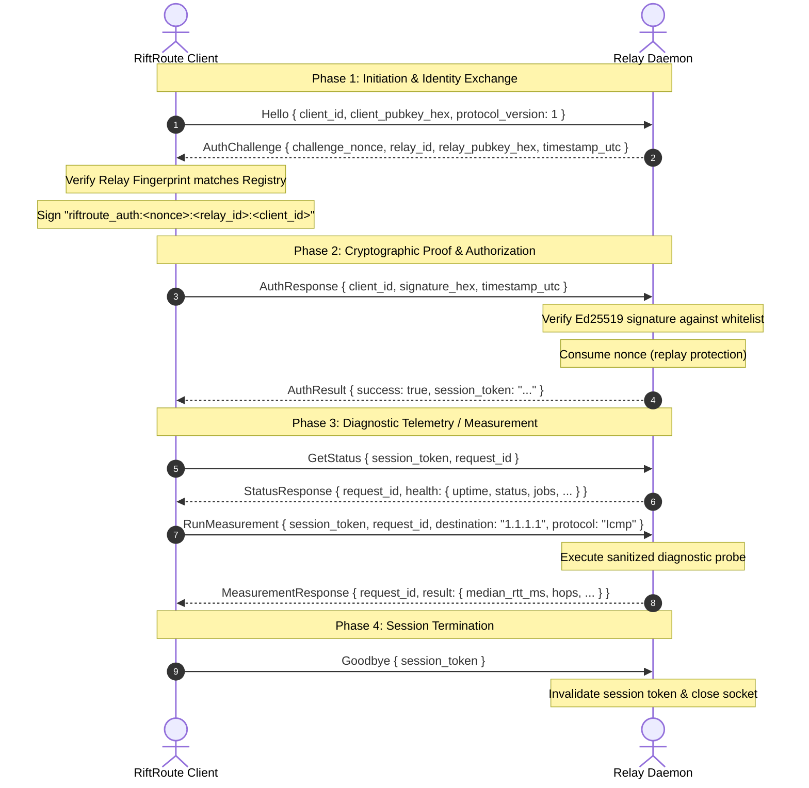

# RiftRoute Phase 4 — Relay Control Protocol v1

## 1. Wire Framing Specification

All communication between the RiftRoute Client and Relay Daemon uses length-delimited JSON frames over a persistent TCP stream (default port: `44321`).

```
+-----------------------------------+-----------------------------------------+
|  Length Header (4 bytes, Big-End) |         JSON Payload (N bytes)          |
+-----------------------------------+-----------------------------------------+
|  [ 0x00, 0x00, 0x01, 0x2A ]       |  { "type": "Hello", "payload": ... }    |
+-----------------------------------+-----------------------------------------+
```

### Safety Bounds
- **Maximum Frame Size**: 65,536 bytes (64 KB). Any header specifying a length exceeding 64 KB results in immediate disconnection.
- **Minimum Frame Size**: Zero-length frames are rejected as malformed.

---

## 2. Handshake & Message Sequence



---

## 3. Message Catalog

All messages are represented as tagged JSON objects:
```json
{
  "type": "<MessageType>",
  "payload": { ... }
}
```

| Message Type | Direction | Payload Fields | Description |
| :--- | :--- | :--- | :--- |
| `Hello` | Client -> Relay | `client_id`, `client_pubkey_hex`, `protocol_version` | Initiate control connection |
| `AuthChallenge` | Relay -> Client | `challenge_nonce`, `relay_id`, `relay_pubkey_hex`, `timestamp_utc` | Return CSPRNG challenge nonce |
| `AuthResponse` | Client -> Relay | `client_id`, `signature_hex`, `timestamp_utc` | Client cryptographic response |
| `AuthResult` | Relay -> Client | `success`, `session_token`, `error` | Authentication outcome |
| `GetStatus` | Client -> Relay | `session_token`, `request_id` | Request relay operational health |
| `StatusResponse` | Relay -> Client | `request_id`, `health` | Uptime, jobs, memory, status |
| `GetCapabilities` | Client -> Relay | `session_token`, `request_id` | Query supported measurement types |
| `CapabilitiesResponse` | Relay -> Client | `request_id`, `capabilities` | List of supported probe engines |
| `RunMeasurement` | Client -> Relay | `session_token`, `request_id`, `destination`, `protocol`, `max_hops`, `timeout_ms` | Execute remote diagnostic probe |
| `MeasurementResponse` | Relay -> Client | `request_id`, `result` | Empirical measurement metrics |
| `Error` | Bidirectional | `request_id`, `failure_mode`, `message` | Protocol or operational failure |
| `Goodbye` | Client -> Relay | `session_token` | Graceful disconnection |
